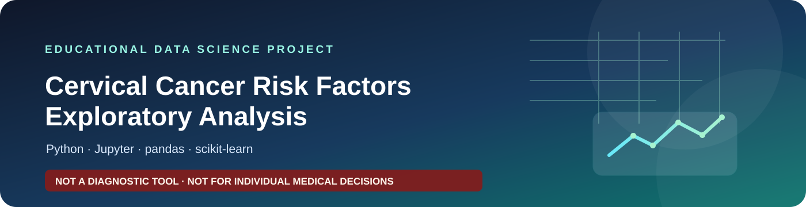
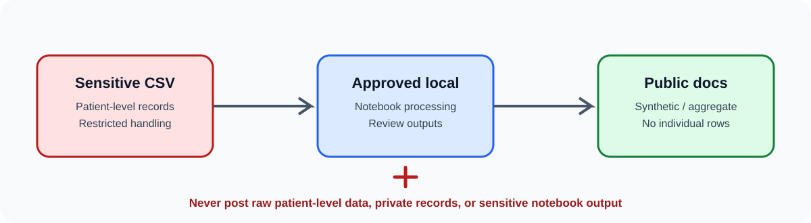
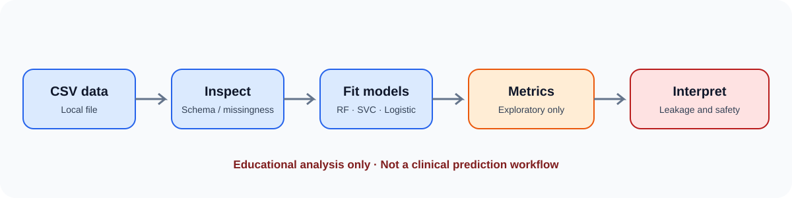
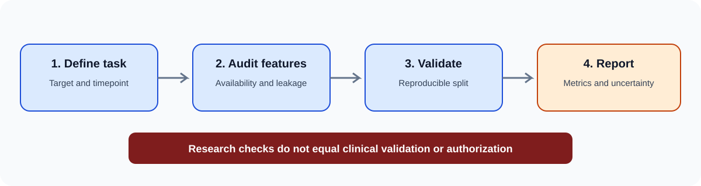

<div align="center">



# 🩺 Cervical Cancer Risk Factors Analysis

### An educational, notebook-based exploration of a cervical-cancer risk-factor dataset

[](https://www.python.org/)
[](https://jupyter.org/)
[](https://scikit-learn.org/)
[](LICENSE)
[](ROADMAP.md)
[](https://github.com/Brajesh31/Cervical-Cancer-Prediction/actions/workflows/quality-checks.yml)

**Important:** This project is for learning and exploratory analysis. It is not a diagnostic system, screening tool, clinical decision-support product, or substitute for professional medical care.

</div>

---

## 🧭 Contents
- [Overview](#-overview)
- [Medical and research safety](#-medical-and-research-safety)
- [What is implemented](#-what-is-implemented)
- [Repository structure](#-repository-structure)
- [Workflow](#-workflow)
- [Dataset and attribution](#-dataset-and-attribution)
- [Environment setup](#-environment-setup)
- [Run the notebook](#-run-the-notebook)
- [Current limitations](#-current-analysis-limitations)
- [Documentation](#-documentation-library)
- [Privacy and governance](#-quality-privacy-and-governance)
- [Contributing](#-contributing)
- [License](#-license)

## 🎯 Overview

This repository contains a Jupyter notebook exploring a tabular dataset associated with cervical-cancer risk factors. It uses Python data-analysis libraries and scikit-learn estimators to demonstrate a basic classification workflow.

The tracked dataset has **858 records and 36 fields**. The notebook uses `Dx:Cancer` as its target and compares Random Forest, Support Vector Classifier (SVC), and Logistic Regression with one train/test split.

The project is a learning resource for data inspection, preprocessing, classification, and evaluation. It does **not** demonstrate reliable prospective risk prediction.

## 🚨 Medical and research safety

> **Do not use this project to make decisions about an individual.**

- It is not a medical device or clinically validated model.
- It must not be used to diagnose, screen, triage, treat, reassure, or estimate an individual's cancer risk.
- A high notebook metric does not establish clinical performance, utility, fairness, or safety.
- Diagnosis and screening variables among the predictors may leak information about the target.
- The dataset contains sensitive health-related information. Never post individual rows, screenshots, or saved notebook outputs in public discussions.
- Medical questions and screening decisions belong with qualified health professionals.

The project has no clinical oversight, prospective validation, external validation, regulatory review, or approved patient-data governance process.



## ✅ What is implemented

| Area | Current repository evidence |
|---|---|
| Data | Tracked CSV with 858 rows and 36 columns |
| Exploration | Notebook with data inspection and feature selection |
| Models | Random Forest, SVC, Logistic Regression |
| Evaluation | One holdout split, selected metrics, accuracy comparison plot |
| Environment | `requirements.txt`, optional `requirements-dev.txt` |
| Serving | No deployed model, inference application, or prediction API |
| Persistence | No application database or model registry |
| Testing | Repository contract and synthetic-CSV tests; no model-validation suite |

This table describes the checked-in project, not a future architecture.

## 🗂️ Repository structure

```text
Cervical-Cancer-Prediction/
├── .github/
│   ├── DISCUSSION_TEMPLATE/
│   ├── ISSUE_TEMPLATE/
│   ├── workflows/
│   │   ├── quality-checks.yml
│   │   └── update-readme.yml
│   ├── dependabot.yml
│   └── pull_request_template.md
├── docs/
│   ├── assets/                 # Accessible SVG project illustrations
│   ├── diagrams/               # Editable Mermaid flowcharts
│   ├── runbooks/               # Maintainer and research procedures
│   ├── templates/              # Reusable research and review forms
│   ├── dataset-card.md
│   ├── model-card.md
│   ├── feature-audit.md
│   ├── methodology.md
│   ├── evaluation-protocol.md
│   ├── validation-strategy.md
│   ├── data-quality.md
│   ├── data-preparation.md
│   ├── data-flow.md
│   ├── privacy.md
│   ├── ethics-and-governance.md
│   ├── research-reporting.md
│   ├── notebook-walkthrough.md
│   └── ... additional project guides
├── scripts/                    # Local repository and schema utilities
├── tests/                       # Synthetic and repository contract tests
├── cervical-cancer-risk-data.ipynb
├── DATA _SET (1).csv
├── requirements.txt
├── requirements-dev.txt
├── pyproject.toml
├── Makefile
├── ACKNOWLEDGMENTS.md
├── GOVERNANCE.md
├── CHANGELOG.md
├── CITATION.cff
├── CODE_OF_CONDUCT.md
├── CONTRIBUTING.md
├── LICENSE
├── ROADMAP.md
├── SECURITY.md
└── SUPPORT.md
```

Folders also contain editable diagrams, runbooks, templates, and repository support assets. Their presence does not imply a production service.

## 🔄 Workflow



The notebook follows this broad sequence:

1. Read the CSV into pandas.
2. Inspect dimensions, missing values, and duplicates.
3. Select features and the `Dx:Cancer` target.
4. Split rows into training and test partitions.
5. Fit three scikit-learn estimators.
6. Print selected metrics and plot an accuracy comparison.

See the [editable workflow diagram](docs/diagrams/research-workflow.mmd), [architecture guide](docs/architecture.md), and [additional diagrams](docs/diagrams/README.md).

Additional visuals: [project banner](docs/assets/project-banner.svg), [privacy boundary](docs/assets/privacy-boundary.svg), and [evaluation gates](docs/assets/evaluation-gates.svg).

## 📊 Dataset and attribution

The CSV has 858 rows and 36 columns. Its schema and dimensions appear consistent with UCI's **Cervical Cancer (Risk Factors)** dataset.

UCI credits Kelwin Fernandes, Jaime Cardoso, and Jessica Fernandes (2017), DOI [10.24432/C5Z310](https://doi.org/10.24432/C5Z310), and lists the dataset under [CC BY 4.0](https://creativecommons.org/licenses/by/4.0/).

This repository does not include a checksum or transformation history proving that its local copy is byte-identical to UCI's release. Verify provenance before redistribution. The MIT license applies to original project code and documentation only; it does not override third-party dataset terms. See [LICENSE](LICENSE) and [data documentation](docs/database.md).

## 🧰 Environment setup

### Prerequisites
- Python 3 compatible with the installed Jupyter and scikit-learn releases.
- Git, if cloning.
- A local environment approved to handle sensitive health-related data.

The repository does not pin all dependency versions or declare a tested Python version. Lock exact versions after validating a reproducible environment.

### 1. Clone
```bash
git clone https://github.com/Brajesh31/Cervical-Cancer-Prediction.git
cd Cervical-Cancer-Prediction
```

### 2. Create a virtual environment

**Windows PowerShell**
```powershell
py -m venv .venv
.\.venv\Scripts\Activate.ps1
```

**macOS / Linux**
```bash
python3 -m venv .venv
source .venv/bin/activate
```

### 3. Install dependencies
```bash
python -m pip install --upgrade pip
python -m pip install -r requirements.txt
```

### 4. Resolve the CSV filename mismatch

The notebook currently reads `data.csv`, but the tracked file is named `DATA _SET (1).csv`. Until the notebook path is corrected, create a local copy:

**Windows PowerShell**
```powershell
Copy-Item "DATA _SET (1).csv" data.csv
```

**macOS / Linux**
```bash
cp "DATA _SET (1).csv" data.csv
```

The local `data.csv` is ignored by Git. Do not commit a duplicate patient-level dataset.

### 5. Launch Jupyter
```bash
jupyter notebook cervical-cancer-risk-data.ipynb
```

Run cells in order in a trusted local environment. Review saved outputs before sharing a modified notebook.

## 🧪 Run the notebook

The notebook is the executable analysis artifact. There is no CLI command, supported inference function, model-serving application, or prediction endpoint.

Before interpreting results, review:
- Whether question-mark sentinels are converted before `dropna()`.
- Whether every predictor is available at the intended prediction time.
- Whether fields such as biopsy or other diagnosis indicators leak the target.
- Whether preprocessing is fitted only on training folds.
- Whether class imbalance is reflected in metrics beyond accuracy.
- Whether split randomness and software versions are recorded.
- Whether saved outputs expose unnecessary record-level information.


## 🧪 Developer tools and repository checks

Optional developer tools are defined separately from notebook runtime dependencies.

```bash
python -m pip install -r requirements-dev.txt
python scripts/validate_project.py
python -m pytest -q
ruff check scripts tests
```

You can also use the Makefile targets where GNU Make is available:

```bash
make install
make install-dev
make validate
make test
make audit-data
```

The repository validator checks required files, notebook JSON, and local Markdown links. The test suite uses repository contracts and synthetic CSV fixtures. The optional dataset audit reads the local dataset but reports only aggregate dimensions and required-header status. GitHub Actions deliberately does not load the patient-level CSV.

See [scripts documentation](scripts/README.md), [test guide](tests/README.md), and [development guide](docs/development.md). These checks do not validate clinical performance.


## ⚠️ Current analysis limitations

1. **File path mismatch:** the notebook reads `data.csv`, which is not the tracked CSV filename.
2. **Missing values:** the question-mark replacement line is commented out; literal sentinels may survive `dropna()`.
3. **Potential target leakage:** diagnosis and screening fields are among predictors for `Dx:Cancer`. This may invalidate an early-prediction interpretation.
4. **Undefined prediction time:** feature availability relative to a prospective decision is undocumented.
5. **Single unseeded split:** results can vary and the split is not stratified.
6. **Limited metrics:** accuracy alone is inadequate, especially with an uncommon positive class.
7. **No external validation:** there is no independent cohort, calibration study, confidence interval, or clinical utility analysis.
8. **No model artifact:** trained estimators are not saved for supported inference.
9. **Saved notebook outputs:** committed outputs may contain record-level data-derived values.
10. **No clinical validation:** software execution is not evidence of medical safety or effectiveness.



A corrected pipeline and stronger metrics would improve research quality, but would not by themselves make this a clinical tool.

## 📚 Documentation library

| Guide | Coverage |
|---|---|
| [Architecture](docs/architecture.md) | Notebook architecture and boundaries |
| [Installation](docs/installation.md) | Environment and CSV path workaround |
| [Development](docs/development.md) | Notebook changes and review |
| [Data and database](docs/database.md) | Dataset, provenance, and storage |
| [Data dictionary](docs/data-dictionary.md) | Field groups and schema cautions |
| [Dataset card](docs/dataset-card.md) | Dataset provenance, scope, and limitations |
| [Model card](docs/model-card.md) | Current estimator description and explicit non-deployment status |
| [Feature audit](docs/feature-audit.md) | Feature timing and target leakage review |
| [Methodology](docs/methodology.md) | Current analysis sequence and recommended improvements |
| [Data preparation](docs/data-preparation.md) | Missing values, path, and preprocessing cautions |
| [Data quality](docs/data-quality.md) | Schema, quality dimensions, and safe reporting |
| [Data flow](docs/data-flow.md) | Current trust boundaries and output risks |
| [Validation strategy](docs/validation-strategy.md) | Research validation steps and limits |
| [Metric glossary](docs/metric-glossary.md) | Classification metric definitions |
| [Experiment tracking](docs/experiment-tracking.md) | Reproducible run records |
| [Notebook walkthrough](docs/notebook-walkthrough.md) | Notebook execution and interpretation guide |
| [Clinical-use boundary](docs/clinical-use-boundary.md) | Explicit exclusions and medical safety rules |
| [Research reporting](docs/research-reporting.md) | How to communicate exploratory results |
| [Publication checklist](docs/publication-checklist.md) | Review before sharing notebooks or reports |
| [Model governance](docs/model-governance.md) | Model change control and approval boundaries |
| [Known issues](docs/known-issues.md) | Verified implementation limitations |
| [Technical debt](docs/technical-debt.md) | Prioritized maintenance backlog |
| [Decision log](docs/decision-log.md) | Recorded project decisions |
| [Release process](docs/release-process.md) | Documentation and code change procedure |
| [Support matrix](docs/support-matrix.md) | Runtime and feature support status |
| [Research ethics checklist](docs/research-ethics-checklist.md) | Responsible-use review |
| [Evaluation protocol](docs/evaluation-protocol.md) | Leakage, splits, metrics, validation |
| [Reproducibility](docs/reproducibility.md) | Environment and run records |
| [Ethics and governance](docs/ethics-and-governance.md) | Responsible research boundaries |
| [Privacy](docs/privacy.md) | Patient-level data and outputs |
| [Accessibility](docs/accessibility.md) | Accessible charts and docs |
| [API status](docs/api.md) | No supported API |
| [Deployment](docs/deployment.md) | No deployable service |
| [Troubleshooting](docs/troubleshooting.md) | Local notebook issues |
| [FAQ](docs/faq.md) | Common questions |
| [Diagrams](docs/diagrams/README.md) | Editable Mermaid diagrams |
| [Runbooks](docs/runbooks/README.md) | Repository and research procedures |
| [Templates](docs/templates/README.md) | Reusable research and review forms |

## 🔐 Quality, privacy and governance

- Never commit credentials, personally identifying information, or additional patient records.
- Use aggregate or synthetic examples in issues and pull requests.
- Inspect notebook JSON diffs for output cells that expose records.
- Preserve dataset attribution and license obligations.
- Do not upload this dataset to unapproved hosted notebooks or third-party tools.
- Treat model outputs as experimental and non-actionable.
- Read [SECURITY.md](SECURITY.md), [privacy guidance](docs/privacy.md), and [ethics and governance](docs/ethics-and-governance.md).

## 🤝 Contributing

Read [CONTRIBUTING.md](CONTRIBUTING.md). Useful work includes correcting the data path, documenting missing-value handling, creating a reproducible evaluation pipeline, auditing feature timing and leakage, and adding tests. Do not submit patient records or unsupported medical claims. Use the repository issue and pull request templates.

## 🗺️ Roadmap

See [ROADMAP.md](ROADMAP.md). Research-quality improvements should precede any deployment discussion. A production or clinical proposal would require independent scientific, clinical, privacy, governance, and regulatory review.

## 🙏 Acknowledgments

Dataset and dependency credits are documented in [ACKNOWLEDGMENTS.md](ACKNOWLEDGMENTS.md). Project decision-making and contribution review are described in [GOVERNANCE.md](GOVERNANCE.md).

## 📄 License

Original project code and documentation are distributed under MIT. Dataset material may carry separate CC BY 4.0 requirements. Read the full [LICENSE](LICENSE) before redistribution.

---

<div align="center">

**Built for learning, reproducible analysis, and responsible research communication.**

⭐ Star the repository if it helps your learning. Do not use it for individual medical decisions.

</div>

Last updated: 2026-11-17 10:33 UTC
